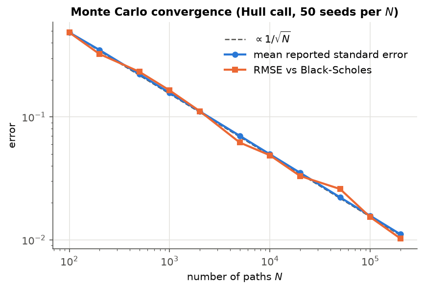
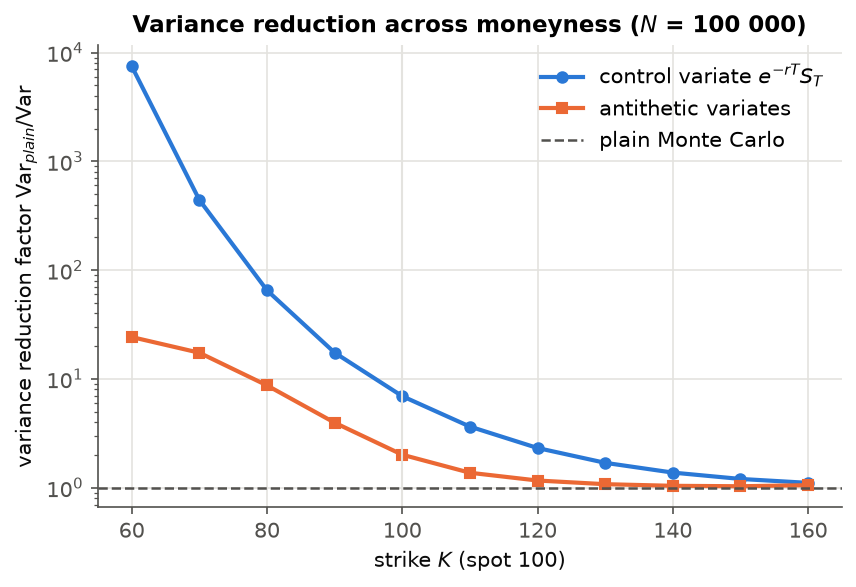
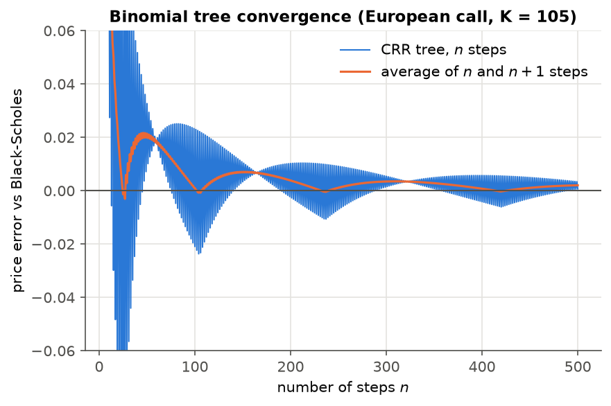
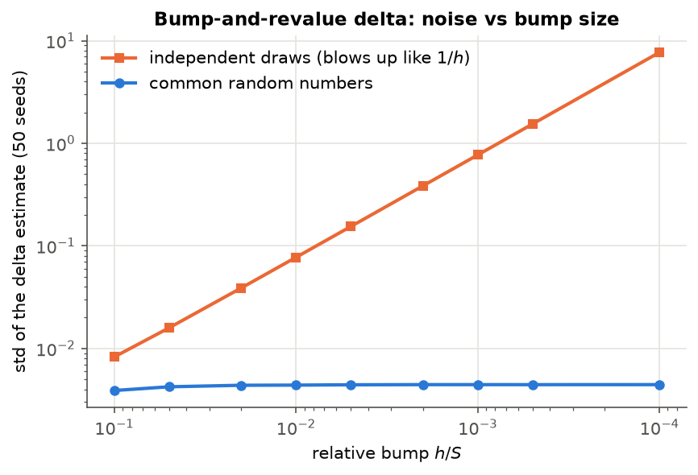
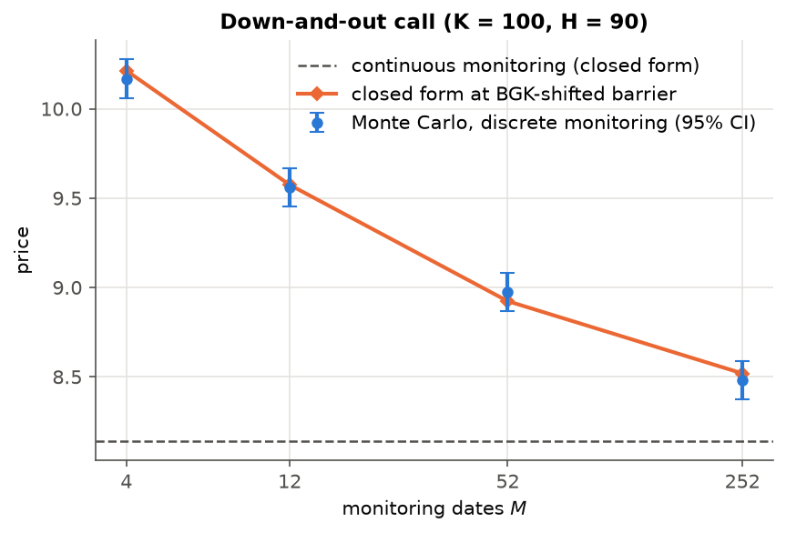

# pricer: Option Pricing Library in Modern C++

[](https://github.com/sawee4/pricer/actions/workflows/ci.yml)

A tested option pricing library written in C++17, with no dependency other than
GoogleTest (fetched automatically by CMake). It prices European and American options with
three independent engines (Black-Scholes closed form, Monte Carlo, CRR binomial tree), computes
Greeks analytically and by simulation, inverts Black-Scholes for the implied volatility, and
prices Asian and barrier options by path simulation.

Every numerical method is checked against a closed form, a textbook value or a no-arbitrage
identity: **480 unit tests**, run by CI on Linux (GCC, Clang) and Windows (MSVC), with warnings
treated as errors. Monte Carlo results are reproducible to the last digit across platforms.

## Contents

- [Features](#features)
- [Quick start](#quick-start)
- [Design](#design)
- [Models and methods](#models-and-methods)
- [Validation](#validation)
- [Build, test and reproduce the figures](#build-test-and-reproduce-the-figures)
- [Project layout](#project-layout)
- [References](#references)

## Features

| Area | What is implemented |
|---|---|
| Closed form | Black-Scholes with continuous dividend yield: calls, puts, cash-or-nothing digitals |
| Greeks | Analytic delta, gamma, vega, theta, rho; Monte Carlo bump-and-revalue (common random numbers), pathwise delta and vega, likelihood ratio delta |
| Monte Carlo | Exact GBM sampling, standard error and 95% confidence interval, antithetic variates, control variate, portable and seedable RNG |
| Trees | Cox-Ross-Rubinstein binomial tree, European and American exercise, O(n) memory |
| Implied volatility | Safeguarded Newton-Raphson (bisection fallback), no-arbitrage checks |
| Exotics | Arithmetic and geometric Asian options, knock-in and knock-out barriers (discrete monitoring), geometric Asian control variate, Broadie-Glasserman-Kou continuity correction |

## Quick start

```cpp
#include <iostream>
#include <memory>

#include "pricer/analytic_pricer.hpp"
#include "pricer/binomial_pricer.hpp"
#include "pricer/monte_carlo_pricer.hpp"

int main() {
    using namespace pricer;

    // Hull, Example 15.6: S = 42, K = 40, r = 10%, sigma = 20%, T = 6 months.
    const MarketData market(/*spot=*/42.0, /*rate=*/0.10, /*dividend=*/0.0, /*vol=*/0.20);
    const Option call(std::make_unique<CallPayoff>(40.0), /*maturity=*/0.5);

    const PricingResult bs = AnalyticPricer().price(call, market);
    const PricingResult mc =
        MonteCarloPricer(100000, /*seed=*/42, VarianceReduction::ControlVariate).price(call, market);
    const PricingResult tree = BinomialPricer(1000).price(call, market);

    std::cout << "Black-Scholes : " << bs.price << '\n'                         // 4.75942
              << "Monte Carlo   : " << mc.price << " +/- " << 1.96 * mc.standardError << '\n'
              << "Binomial tree : " << tree.price << '\n'
              << "Delta         : " << AnalyticPricer().greeks(call, market).delta << '\n';
}
```

Link against the `pricer` target from CMake (`target_link_libraries(app PRIVATE pricer)`).
More complete programs are in [`examples/`](examples).

## Design

| Component | Responsibility |
|---|---|
| `Payoff` | Terminal payoff $h(S_T)$: call, put, digital call and put. Polymorphic, deep-copied with `clone()` |
| `Option` | Contract: payoff, maturity and exercise style (European or American). Owns its payoff (RAII, copy-and-swap) |
| `MarketData` | Black-Scholes inputs $S, r, q, \sigma$, validated at construction, immutable (`withSpot`, `withVolatility`, ... return bumped copies) |
| `Pricer` | Engine interface returning a `PricingResult` (price, standard error, 95% interval): `AnalyticPricer`, `MonteCarloPricer`, `BinomialPricer` |
| `PathPayoff`, `PathDependentPricer` | Path-dependent contracts (Asian, barrier) and their Monte Carlo engine |
| `black_scholes`, `closed_form`, `mc_greeks` | Free functions: formulas used by the engines and by the tests |

Design choices:

- **Separation of contract, market and method.** The same `Option` is priced by every engine,
  which is what makes cross-validation between engines cheap to write.
- **No global state.** Every random engine is owned by the call that uses it and seeded
  explicitly, so a result depends only on its inputs and its seed.
- **Portable randomness.** `std::normal_distribution` is implementation-defined, so the same
  seed gives different numbers with libstdc++ and MSVC. The library draws 64-bit integers from
  `std::mt19937_64` (fully specified by the standard), builds uniforms from the top 53 bits and
  applies an inverse normal CDF (Wichura's AS241). The outputs are bit-identical on Linux and
  Windows.
- **Errors are exceptions** (`std::invalid_argument` for bad inputs, `std::domain_error` when a
  result does not exist), never silent NaNs.

## Models and methods

### Black-Scholes

Under the risk-neutral measure the underlying follows
$dS_t = (r - q) S_t\,dt + \sigma S_t\,dW_t$. With the forward $F = S e^{(r-q)T}$,

$$
C = e^{-rT}\left[F\,N(d_1) - K\,N(d_2)\right], \qquad
P = e^{-rT}\left[K\,N(-d_2) - F\,N(-d_1)\right],
$$

$$
d_1 = \frac{\ln(F/K) + \tfrac12\sigma^2 T}{\sigma\sqrt T}, \qquad d_2 = d_1 - \sigma\sqrt T .
$$

$N$ is computed from `std::erfc`, which keeps full relative precision in the far tails. When
$\sigma\sqrt T \to 0$ the price falls back to its deterministic limit
$e^{-rT}(F-K)^+$.

Analytic Greeks (call): $\Delta = e^{-qT}N(d_1)$,
$\Gamma = e^{-qT}\varphi(d_1)/(S\sigma\sqrt T)$, $\mathcal V = S e^{-qT}\varphi(d_1)\sqrt T$,
plus theta and rho. They are tested against central finite differences with steps scaled by
$S\sigma\sqrt T$.

### Monte Carlo

The terminal price is sampled exactly, without time discretisation:

$$
S_T = S_0 \exp\left[\left(r - q - \tfrac12\sigma^2\right)T + \sigma\sqrt T\,Z\right],
\qquad Z \sim \mathcal N(0,1).
$$

The estimator $\hat V = e^{-rT}\frac1N\sum_i h(S_T^{(i)})$ is reported with its standard error
$\hat s/\sqrt N$ (Welford's online variance) and the interval $\hat V \pm 1.96\,\hat s/\sqrt N$.

- **Antithetic variates** average $h(S_T(Z))$ and $h(S_T(-Z))$. The gain is large when the
  payoff is close to monotone and linear in $Z$ (deep in the money).
- **Control variate** uses $X = e^{-rT}S_T$, whose mean $S_0e^{-qT}$ is known:
  $\hat V_{cv} = \bar Y - \hat\beta(\bar X - S_0e^{-qT})$ with
  $\hat\beta = \widehat{\mathrm{Cov}}(X,Y)/\widehat{\mathrm{Var}}(X)$. The variance is
  multiplied by $1-\rho_{XY}^2$.

### Monte Carlo Greeks

- **Bump and revalue**: $\Delta \approx [V(S+h) - V(S-h)]/2h$. With **common random numbers**
  (the same draws for both prices) the variance is $O(1/N)$ for any $h$. With independent draws
  it grows like $1/(h^2N)$.
- **Pathwise**: differentiate the payoff along each path.
  For a call, $\Delta = e^{-rT}\,\mathbb E\left[\mathbf 1_{S_T>K}\,S_T/S_0\right]$.
  This is unbiased because the payoff is Lipschitz.
- **Likelihood ratio**: differentiate the density instead,
  $\Delta = e^{-rT}\,\mathbb E\left[h(S_T)\,Z/(S_0\sigma\sqrt T)\right]$. It works for
  discontinuous payoffs, but it is noisier.

### Binomial tree (Cox-Ross-Rubinstein)

With $\Delta t = T/n$: $u = e^{\sigma\sqrt{\Delta t}}$, $d = 1/u$,
$p = (e^{(r-q)\Delta t} - d)/(u - d)$. Pricing throws when $p \notin [0,1]$,
since such a tree admits arbitrage. Backward induction:

$$
V_{i,j} = e^{-r\Delta t}\left[p\,V_{i+1,j+1} + (1-p)\,V_{i+1,j}\right],
\qquad V^{\text{US}}_{i,j} = \max\left(V_{i,j},\ h(S_{i,j})\right).
$$

It uses one vector of size $n+1$. The error of the European price is $O(1/n)$ and oscillates
with the parity of $n$ and with the position of $\ln K$ relative to the terminal nodes.

### Implied volatility

The solver finds $\sigma$ such that $BS(\sigma) = P_{\text{market}}$. A price exists only
inside the no-arbitrage bounds, which for a call are
$(S e^{-qT} - K e^{-rT})^+ < C < S e^{-qT}$. The solver is a safeguarded Newton method:

- It keeps a bracket $[\sigma_{lo}, \sigma_{hi}]$ (the price is increasing in $\sigma$).
- It takes the Newton step $\sigma - (BS(\sigma) - P)/\mathcal V$ when that step stays inside
  the bracket, and bisects otherwise.
- It starts from the Manaster-Koehler point $\sigma_0 = \sqrt{2\,|\ln(F/K)|/T}$.

### Asian and barrier options

Paths are simulated exactly at the monitoring dates $t_k = kT/M$, in log space.

- **Geometric Asian.** The geometric average $G$ is lognormal, with
  $\ln G \sim \mathcal N(\mu, s^2)$, where
  $\mu = \ln S_0 + (r - q - \tfrac12\sigma^2)\,T\,\tfrac{M+1}{2M}$ and
  $s^2 = \sigma^2T\,\tfrac{(M+1)(2M+1)}{6M^2}$. Its price is therefore a Black formula.
- **Arithmetic Asian.** It has no closed form. It is priced by Monte Carlo with the
  geometric Asian as control variate (Kemna-Vorst).
- **Barriers.** In + out = vanilla path by path. The continuously monitored down-and-in call
  has a closed form (Hull). A barrier monitored every $\Delta t$ is priced by that formula at
  the shifted barrier $H e^{\pm\beta\sigma\sqrt{\Delta t}}$, with
  $\beta = -\zeta(1/2)/\sqrt{2\pi} \approx 0.5826$ (Broadie, Glasserman and Kou).

## Validation

All numbers below are produced by the example programs (and checked by the unit tests).

### Textbook values

| Check | Expected | Library |
|---|---|---|
| Hull 15.6 call, S=42, K=40, r=10%, σ=20%, T=0.5 | 4.76 | 4.759422 |
| Hull 15.6 put | 0.81 | 0.808599 |
| Put-call parity $C - P = Se^{-qT} - Ke^{-rT}$ | 3.950823 | 3.950823 |
| Hull 21.1 American put (S=K=50, r=10%, σ=40%, T=5m), 5 / 30 / 50 / 100 / 500 steps | 4.49 / 4.263 / 4.272 / 4.278 / 4.283 | within 5e-3 / 5e-4 |
| Hull implied vol, call S=21, K=20, r=10%, T=0.25, price 1.875 | 23.5% | 23.45% |

### Identities and limits checked by the tests

- Put-call parity over a grid of strikes, maturities, rates and dividends; $\sigma \to 0$ and
  $T \to 0$ limits; digital call + digital put $= e^{-rT}$.
- Analytic Greeks against central finite differences over a parameter grid.
- American put $\ge$ European put. An American call without dividends equals the European
  call to $10^{-12}$ (Merton). With a large dividend yield, early exercise has strictly
  positive value.
- Implied volatility round trip over a grid of 7 volatilities × 5 strikes × 3 maturities ×
  call/put, to $10^{-10}$. Arbitrageable prices are rejected.
- Knock-in + knock-out = vanilla on the same paths, to $10^{-10}$. The geometric Asian closed
  form with one fixing reduces to Black-Scholes.

### Monte Carlo convergence

Hull call, 50 independent seeds per $N$. The reported standard error and the realised RMSE
against Black-Scholes agree, and both decay like $1/\sqrt N$. The fitted log-log slope of the
RMSE is **−0.508** (theory: −0.5).



### Variance reduction

Calls with S=100, r=5%, σ=20%, T=1, and N = 100,000 payoff evaluations for every method. The
reduction factor is $\mathrm{Var}_{\text{plain}}/\mathrm{Var}_{\text{method}}$, which is also
the speed-up at equal accuracy.

| Strike | 60 | 80 | 100 | 120 | 140 | 160 |
|---|---|---|---|---|---|---|
| Antithetic | ×24.2 | ×8.7 | ×2.0 | ×1.2 | ×1.0 | ×1.0 |
| Control variate $e^{-rT}S_T$ | ×7483 | ×65 | ×6.9 | ×2.3 | ×1.4 | ×1.1 |

Deep in the money the call is almost linear in $S_T$, so both techniques are very effective.
Out of the money most paths pay zero, the payoff decorrelates from $S_T$, and the gain
vanishes.



### Binomial tree

European call with S=100, K=105, r=5%, q=2%, σ=25%, T=1 (Black-Scholes price 8.941176). The
raw CRR error oscillates between odd and even $n$. Averaging the $n$ and $n+1$ trees removes
the oscillation and leaves the slower $O(1/n)$ component.



### Monte Carlo Greeks

Call with S=100, K=105, r=5%, q=2%, σ=25%, T=1, N = 100,000 paths.

| Method | Delta | Vega |
|---|---|---|
| Analytic | 0.50958 | 39.0557 |
| Bump and revalue, common random numbers | 0.50749 | 39.0539 |
| Bump and revalue, independent draws | 0.44108 | 41.5116 |
| Pathwise | 0.50759 (SE 0.0019) | 39.0539 (SE 0.24) |
| Likelihood ratio | 0.51084 (SE 0.0042) | — |

The standard deviation of the bumped delta over 50 seeds is flat in $h$ with common random
numbers. With independent draws it grows like $1/h$, reaching 7.7 at $h/S = 10^{-4}$.



### Implied volatility

Calls priced at σ = 25% (S=100, r=5%, q=2%, T=1), then inverted:

| Strike | 60 | 80 | 100 | 120 | 160 |
|---|---|---|---|---|---|
| Implied vol | 0.2500000000 | 0.2500000000 | 0.2500000000 | 0.2500000000 | 0.2500000000 |
| Iterations | 8 | 6 | 3 | 5 | 7 |

### Asian option with geometric control variate

Arithmetic Asian call, K=100, 52 weekly fixings, 100,000 paths (S=100, r=5%, q=2%, σ=25%,
T=1):

| Estimator | Price | Standard error |
|---|---|---|
| Vanilla call (Black-Scholes, for scale) | 11.12376 | — |
| Geometric Asian (closed form) | 6.07465 | — |
| Arithmetic Asian, plain Monte Carlo | 6.39658 | 0.03074 |
| Arithmetic Asian, geometric control variate | 6.36728 | 0.00102 |

The control variate divides the variance by **915**, the equivalent of 915 times more paths.

### Barrier option: discrete monitoring

Down-and-out call, K=100, H=90, same market. The continuously monitored price is 8.13881.
Monitoring only at $M$ dates misses crossings between dates, so the knock-out survives more
often and is worth more. The Broadie-Glasserman-Kou shifted barrier reproduces the discrete
price within the Monte Carlo error:

| Monitoring dates $M$ | 4 | 12 | 52 | 252 |
|---|---|---|---|---|
| Monte Carlo (100,000 paths) | 10.168 ± 0.108 | 9.559 ± 0.107 | 8.974 ± 0.106 | 8.481 ± 0.105 |
| Closed form at the BGK barrier | 10.213 | 9.574 | 8.923 | 8.519 |



## Build, test and reproduce the figures

Requirements: CMake ≥ 3.16 and a C++17 compiler (GCC, Clang, MSVC or MinGW). GoogleTest is
downloaded at configure time.

```bash
cmake -S . -B build -DCMAKE_BUILD_TYPE=Release
cmake --build build --config Release --parallel
ctest --test-dir build -C Release --output-on-failure
```

On Windows with MinGW, add `-G "MinGW Makefiles"`. CMake options:

| Option | Default | Effect |
|---|---|---|
| `PRICER_BUILD_TESTS` | `ON` | Build the GoogleTest suite |
| `PRICER_BUILD_EXAMPLES` | `ON` | Build the example programs |
| `PRICER_WARNINGS_AS_ERRORS` | `OFF` | `-Werror` / `/WX` (on in CI) |

The figures are generated from the CSV files written by the examples
(Python 3 and matplotlib):

```bash
cd docs/data
for p in convergence_study variance_reduction_study binomial_convergence mc_greeks_study exotics_study; do
    ../../build/examples/$p
done
cd ../..
python scripts/plot_results.py
```

## Project layout

```
include/pricer/   public headers (one class or one group of formulas per header)
src/              implementation
tests/            GoogleTest suite (480 tests)
examples/         programs that print the tables above and write the CSV files
scripts/          plot_results.py: CSV -> figures
docs/data/        CSV outputs used for the figures
docs/figures/     generated figures
.github/          CI: Linux GCC, Linux Clang, Windows MSVC
```

## References

- J. C. Hull, *Options, Futures, and Other Derivatives*, Pearson.
- P. Glasserman, *Monte Carlo Methods in Financial Engineering*, Springer, 2003.
- J. C. Cox, S. A. Ross, M. Rubinstein, "Option pricing: a simplified approach",
  *Journal of Financial Economics*, 1979.
- M. Broadie, P. Glasserman, S. Kou, "A continuity correction for discrete barrier options",
  *Mathematical Finance*, 1997.
- A. G. Z. Kemna, A. C. F. Vorst, "A pricing method for options based on average asset values",
  *Journal of Banking and Finance*, 1990.
- M. J. Wichura, "Algorithm AS 241: The percentage points of the normal distribution",
  *Applied Statistics*, 1988.
- S. Manaster, G. Koehler, "The calculation of implied variances from the Black-Scholes model",
  *Journal of Finance*, 1982.
